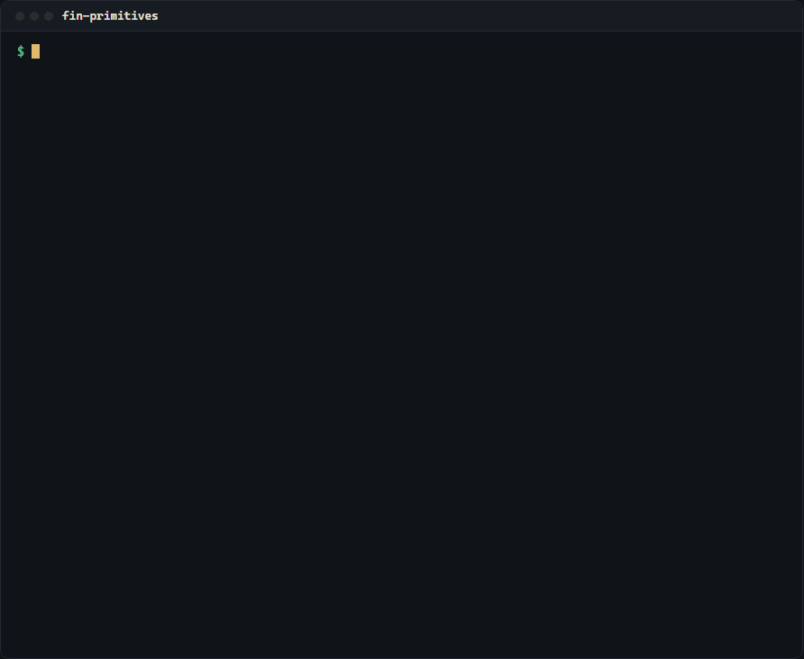
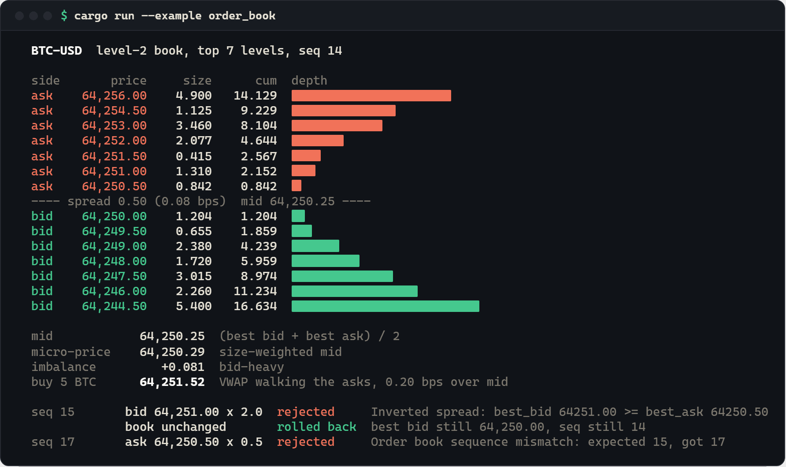
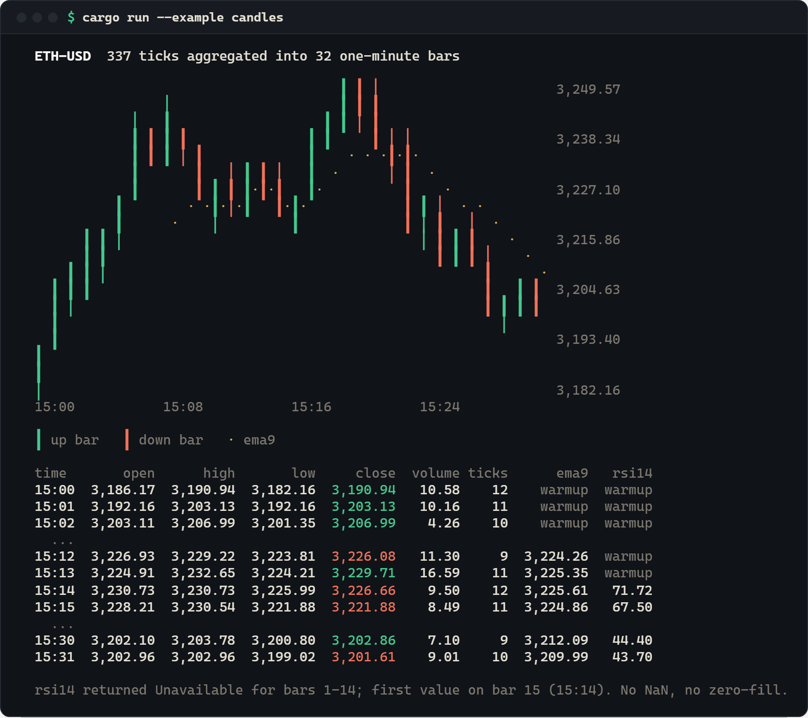
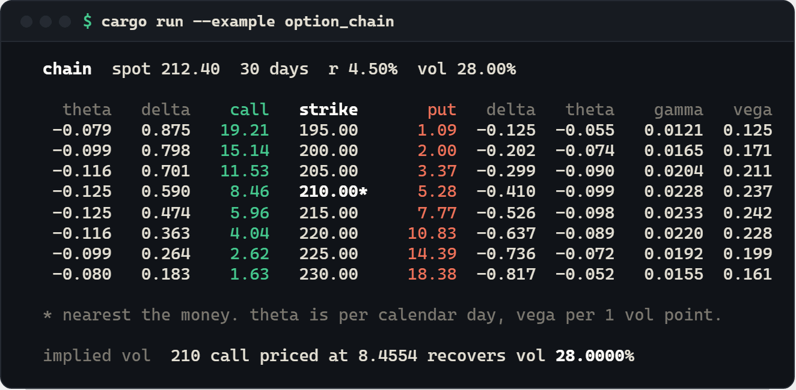

# fin-primitives

**A Rust library of the basic parts every trading program needs: exact prices that refuse bad values, an order book, candles built from trades, 700+ indicators, option pricing and risk limits.**

For Rust developers writing trading bots, backtesters, market-data tools or quant research code who do not want to rebuild (and re-debug) the same pieces.

<p align="center">
  <a href="https://crates.io/crates/fin-primitives"></a>
  <a href="https://docs.rs/fin-primitives"></a>
  <a href="https://github.com/Mattbusel/fin-primitives/blob/main/LICENSE"></a>
</p>

<p align="center">
  
</p>

## Install

```bash
cargo add fin-primitives rust_decimal rust_decimal_macros
```

It is a library, so there is nothing to download or install system-wide (Rust 1.81 or newer).
`rust_decimal_macros` gives you the `dec!(64250.50)` literal used in every example. Or in
`Cargo.toml`: `fin-primitives = "2.14"`. Want to see it first? `git clone https://github.com/Mattbusel/fin-primitives && cd fin-primitives && cargo run --example order_book`.

## How it works

Trades come in as `Tick`s. `OhlcvAggregator::push_tick` drops each one into a time bucket and
hands back the finished candle the moment a trade for the next bucket arrives. Candles feed
indicators, which say `Unavailable` until they have enough history instead of making up a number.

<p align="center"></p>

Money works the same way: fills and price marks go into a `PositionLedger`, its account value
goes into a `RiskMonitor`, and every rule that is broken comes back as a `RiskBreach` you can act on.

<p align="center"></p>

## Examples

Four programs ship in [`examples/`](examples/). No network, no API keys, same output every run.

| Run this | You get |
|---|---|
| `cargo run --example order_book` | a BTC-USD depth ladder, spread, micro-price, the cost of a 5 BTC market buy, and two bad updates rejected |
| `cargo run --example candles` | 337 trades rolled into 32 one-minute candles, drawn with EMA(9) and RSI(14) |
| `cargo run --example position_risk` | a trading session marked to market, with a drawdown rule and an equity floor firing |
| `cargo run --example option_chain` | a Black-Scholes option chain with Greeks and an implied-volatility round trip |

**`order_book`**: the book knows its spread and middle price, and refuses updates that would cross it or skip a sequence number.

<p align="center"></p>

**`position_risk`** (real output, run 2026-09-28, `NO_COLOR=1`):

```text
  #   event                        equity  drawdown  risk
  5   sell 100 AAPL @ 179.10   101,237.00     0.00%  ok
  6   mark MSFT 398.10          99,865.00     1.36%  ok
  7   mark AAPL 166.80          98,635.00     2.57%  ok
  8   mark MSFT 371.50          96,507.00     4.67%  BREACH max_drawdown, min_equity
        max_drawdown: drawdown 4.67% > 4.00%
        min_equity: equity 96507.00 < floor 96600

  rejected  buy 1000 AAPL  Insufficient funds: need 171351.00, have 79866.00
```

(rows 1 to 4 and 9 to 10 cut for length; the diagram above plays the whole session.)

<details>
<summary><b>candles</b> and <b>option_chain</b> output</summary>

<br>

<p align="center"></p>

<p align="center"></p>

</details>

## Use it in 3 steps

**1. Make a project and add the crate**

```bash
cargo new book-demo && cd book-demo
cargo add fin-primitives rust_decimal rust_decimal_macros
```

**2. Put this in `src/main.rs`**

```rust
use fin_primitives::orderbook::{BookDelta, DeltaAction, OrderBook};
use fin_primitives::types::{Price, Quantity, Side, Symbol};
use rust_decimal_macros::dec;

fn main() -> Result<(), fin_primitives::FinError> {
    // 1. Values are checked when you create them.
    println!("Price::new(-5) -> {}", Price::new(dec!(-5)).unwrap_err());

    // 2. Build a small BTC-USD order book from four quotes.
    let mut book = OrderBook::new(Symbol::new("BTC-USD")?);
    let quotes = [
        (Side::Ask, dec!(64250.50), dec!(0.842)),
        (Side::Ask, dec!(64251.00), dec!(1.310)),
        (Side::Bid, dec!(64250.00), dec!(1.204)),
        (Side::Bid, dec!(64249.50), dec!(0.655)),
    ];
    for (seq, (side, price, qty)) in (1..).zip(quotes) {
        book.apply_delta(BookDelta {
            side,
            price: Price::new(price)?,
            quantity: Quantity::new(qty)?,
            action: DeltaAction::Set,
            sequence: seq,
        })?;
    }

    // 3. Ask it questions.
    println!("spread         {}", book.spread().unwrap_or_default());
    println!("mid price      {}", book.mid_price().unwrap_or_default());
    let one_btc = Quantity::new(dec!(1))?;
    println!("buy 1 BTC at   {} average", book.vwap_for_qty(Side::Ask, one_btc)?.round_dp(2));
    Ok(())
}
```

**3. Run it**

```bash
cargo run
```

You will see:

```text
Price::new(-5) -> Price must be positive, got -5
spread         0.50
mid price      64250.25
buy 1 BTC at   64250.58 average
```

A negative price never gets into your program, the book knows its own spread and middle
price, and "what would buying 1 BTC cost" is one call (0.842 BTC fill at the best ask, the
other 0.158 at the next level up). This exact program was built against fin-primitives
2.14 from crates.io and run on 2026-09-28.

## Documentation

| Read this | For |
|---|---|
| [docs.rs/fin-primitives](https://docs.rs/fin-primitives) | every type and method, with examples that compile |
| [docs/ARCHITECTURE.md](docs/ARCHITECTURE.md) | how the modules connect, what each one guarantees, design rules, writing your own indicator or risk rule |
| [docs/REFERENCE.md](docs/REFERENCE.md) | module guides (indicators, series analytics, ledger, drawdown, attribution, Greeks, regimes, backtester, Monte Carlo, factor models, yield curves and more), math definitions, API listing |
| [docs/TESTING.md](docs/TESTING.md) | running the tests and benchmarks, current test status |
| [CHANGELOG.md](CHANGELOG.md) | what changed in each version |
| [Project site](https://mattbusel.github.io/fin-primitives/) | the same overview as a web page |

Optional Python bindings are behind the `python` feature (`maturin develop --features python`).

> Research and engineering library. It does not place orders, and nothing here is financial advice.

## Contributing

Issues and pull requests are welcome. Public items need `///` docs, fallible code returns
`Result` (no `unwrap`, `expect` or `panic!` outside tests), and new behavior needs a test.
Run `cargo fmt`, `cargo clippy` and `cargo test --doc` before opening a PR. See
[CONTRIBUTING.md](CONTRIBUTING.md).

## License and related projects

MIT, see [LICENSE](LICENSE). [fin-stream](https://github.com/Mattbusel/fin-stream) builds on
this crate: it turns live Binance, Coinbase, Alpaca and Polygon trade messages into ticks,
bars and order books.
